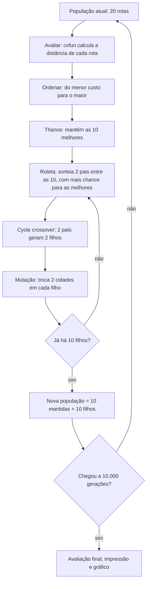

# T2 — Algoritmo Genético para o Caixeiro-Viajante

Guia da equipe para entender (e apresentar) o código da pasta `BUSCA GENETICOS/`. Para cada arquivo: **o que faz**, **qual regra do enunciado cumpre** e **por que foi feito assim**.

---

## 1. O problema em uma página

Um caixeiro-viajante precisa visitar **20 cidades**, passando **uma única vez** por cada uma, e **voltar à cidade de onde saiu**. O objetivo é achar a ordem de visita com a **menor distância total**.

| Conceito do AG | No nosso problema |
|---|---|
| **Indivíduo / cromossomo** | uma rota: permutação dos números 1 a 20 (ex.: `[5 7 18 20 … 14]`) |
| **Gene** | uma cidade da rota |
| **População** | 20 rotas ao mesmo tempo |
| **Aptidão (fitness)** | distância total da rota, com a volta à cidade inicial. **Quanto menor, melhor** |
| **Geração** | uma rodada de avaliar → selecionar → cruzar → mutar |

Por que não testar todas as rotas? Com 20 cidades existem 20! ≈ 2,4 × 10¹⁸ ordens possíveis, o que torna inviável percorrer todas. O AG é uma **busca local com população**: parte de rotas aleatórias e as melhora aos poucos, combinando as boas (crossover) e introduzindo pequenas variações (mutação).

A distância usada é a euclidiana, e é simétrica (`d(a,b) = d(b,a)`), como o enunciado pede:

```
D = Σ  √((x[k+1] − x[k])² + (y[k+1] − y[k])²)    com a cidade n+1 = cidade 1
```

---

## 2. Regras do enunciado × onde estão no código

| Regra do enunciado | Valor | Onde |
|---|---|---|
| Número de cidades | 20, coordenadas entre (0,0) e (1,1) | [cidades.py](cidades.py) |
| Cromossomo | permutação de 1 a 20 | [main.py:27](main.py#L27) |
| Aptidão = distância total com retorno | `cvfun` | [fitness.py:5](fitness.py#L5) |
| Tamanho da população | 20 | [main.py:11](main.py#L11) (`NPOP`) |
| Número de iterações | 10.000 | [main.py:12](main.py#L12) (`N_ITER`) |
| Manter metade da população | 10 melhores | [main.py:21](main.py#L21), [main.py:53-54](main.py#L53-L54) |
| Probabilidade distribuída inversamente ao ranking | pesos lineares 10/55 … 1/55 | [roleta.py:6](roleta.py#L6) |
| Seleção pelo método da roleta | soma acumulada + sorteio | [roleta.py:15](roleta.py#L15) |
| Crossover *cycle* (Figura 1) | troca em cadeia até não haver duplicado | [crossover.py:6](crossover.py#L6) |
| Mutação: troca dois inteiros, em cada membro novo | troca de 2 posições em cada filho | [mutacao.py:5](mutacao.py#L5), [main.py:68](main.py#L68) |
| Mostrar: tamanho da população, população inicial e final, nº de cidades, melhor custo, melhor solução | impressão no terminal | [main.py:100](main.py#L100) |
| Plot dos pontos e do melhor caminho | matplotlib | [main.py:117](main.py#L117) |

---

## 3. Fluxo de uma geração



Correspondência com os passos que a professora passou na lousa:

| Lousa | O que é | Arquivo |
|---|---|---|
| ① Traduzir Def | traduzir a função de custo `cvfun` do Matlab para Python | `fitness.py` |
| ② Criar 20 indivíduos | população inicial aleatória | `main.py` |
| ③ Avaliar e ORDENAR | custo de cada rota e ordenação | `fitness.py` + `thanos.py` |
| ④ Thanos | eliminar metade da população | `thanos.py` |
| ⑤ Roleta c/ pesos lineares | escolher os pais | `roleta.py` |
| ⑥ Cycle crossover | gerar os filhos | `crossover.py` |
| (enunciado) Mutação | variar os filhos | `mutacao.py` |

---

## 4. Arquivo por arquivo

### 4.1 `cidades.py` — as coordenadas

**O que faz:** guarda as 20 cidades numa matriz `CIDADES` de 2 × 20. A **linha 0** tem os `x` e a **linha 1** tem os `y`. A cidade *k* fica em `(CIDADES[0][k-1], CIDADES[1][k-1])`.

**Por quê:** o enunciado permite gerar as coordenadas aleatoriamente ou usar o arquivo `cidades.mat` da professora. Usamos coordenadas **fixas** porque assim todas as execuções resolvem o mesmo mapa e os resultados podem ser comparados entre si (e com os de outros grupos que usem o mesmo arquivo).

---

### 4.2 `fitness.py` — a função de custo (`cvfun`)

**O que faz:** recebe a população (matriz 20 × 20, uma rota por linha) e devolve um vetor com a distância total de cada rota.

**Como funciona (é a tradução linha a linha do Matlab da professora):**

1. `tour = np.column_stack((pop, pop[:, 0]))` copia a 1ª cidade para o fim de cada rota (matriz 20 × 21). Isso força a **volta à cidade inicial**.
2. Monta a matriz `dcidade[i, j]` com a distância entre todas as cidades.
3. Para cada rota, soma `dcidade` entre cada cidade e a seguinte.

**Detalhe importante, o `- 1`:** as cidades vão de **1 a 20** (como no enunciado), mas os índices em Python vão de **0 a 19**. Por isso `cidade_atual = int(tour[i, j]) - 1`. No Matlab isso não era preciso, porque lá os índices começam em 1.

**Exemplo** (é o teste `test_quadrado_unitario`): 4 cidades nos cantos de um quadrado de lado 1.
- Rota `[1 2 3 4]` → 1 + 1 + 1 + 1 = **4,0** (contorna o quadrado).
- Rota `[1 3 2 4]` → 1 + √2 + 1 + √2 ≈ **4,83** (cruza pelas diagonais e fica pior).

**Por quê assim:** a professora pediu explicitamente para traduzir o `cvfun` (passo ① da lousa), então a estrutura original foi mantida. A matriz de distâncias é recalculada a cada chamada, como no Matlab. Daria para calculá-la uma vez só, mas as 10.000 gerações rodam em poucos segundos, então ficou fiel ao original.

---

### 4.3 `thanos.py` — "estala os dedos" e metade da população some

**O que faz:** quatro funções pequenas.

| Função | Faz |
|---|---|
| `atribuir_idx(Npop, fit)` | junta cada indivíduo com o seu custo: lista de `(índice, custo)` |
| `ordenar(individuos)` | ordena pelo custo, do **menor (mais apto)** para o maior |
| `corta_melhores(individuos)` | fica com os 10 primeiros da lista |
| `thanos(pop, melhores_idx)` | monta a matriz só com as rotas sobreviventes, já em ordem de aptidão |

**Regra do enunciado:** "mantemos a metade da população atual e geramos a outra metade por seleção e crossover".

**Por quê:** guardar o índice junto do custo permite ordenar sem perder de vista qual linha da matriz é qual rota. A matriz dos sobreviventes sai **ordenada**, e isso importa para a roleta: a posição 0 é a melhor rota e recebe o maior peso.

> Observação: `corta_melhores` tem o 10 fixo. O `main.py` faz o mesmo corte com `individuos_ordenados[:n_manter]`, que funciona com qualquer tamanho de população (ver 4.7).

---

### 4.4 `roleta.py` — seleção dos pais com pesos lineares

**O que faz:** escolhe quem vai reproduzir, dando mais chance às rotas melhores.

**`probabilidades(n_manter)`:** os pesos são 10, 9, 8, …, 1 (o 1º do ranking pesa 10 e o último pesa 1), divididos pela soma 1 + 2 + … + 10 = **55**:

| Posição no ranking | 1º | 2º | 3º | 4º | 5º | 6º | 7º | 8º | 9º | 10º |
|---|---|---|---|---|---|---|---|---|---|---|
| Probabilidade | 10/55 = 18,2% | 16,4% | 14,5% | 12,7% | 10,9% | 9,1% | 7,3% | 5,5% | 3,6% | 1/55 = 1,8% |
| Acumulada | 0,182 | 0,345 | 0,491 | 0,618 | 0,727 | 0,818 | 0,891 | 0,945 | 0,982 | 1,000 |

**`sortear_pai(prob)`:** a roleta propriamente dita. Cada indivíduo ocupa uma "fatia" do intervalo [0, 1) proporcional à sua probabilidade (a linha "Acumulada" acima). Sorteia-se um número `r` entre 0 e 1, e o pai é o dono da fatia onde `r` caiu. Exemplo: `r = 0,40` está entre 0,345 e 0,491, então o escolhido é o **3º** do ranking.

**Por que "inversamente" e linear:**
- O enunciado diz que os cromossomos ficam em ordem crescente de custo (do mais apto ao menos apto) e que a probabilidade é distribuída **inversamente**. Logo, menor custo dá maior chance.
- Os pesos são pelo **ranking** (posição), não pelo valor do custo. Com isso, uma rota muito melhor que as outras não "domina" a roleta e a população demora mais a ficar toda igual.
- Mesmo o pior dos mantidos tem 1,8% de chance. Isso preserva um pouco de diversidade.

---

### 4.5 `crossover.py` — recombinação *cycle*

**O que faz:** recebe dois pais e uma posição e devolve dois filhos que misturam os pais.

**Por que não um crossover comum (corta e cola)?** Porque a rota tem de conter **cada cidade exatamente uma vez**. Se cortarmos `[4 1 5 | 3 2 6]` e colarmos com `[3 4 6 | 2 1 5]`, sai `[4 1 5 2 1 5]`: as cidades 1 e 5 aparecem duas vezes e as cidades 3 e 6 somem. O *cycle crossover* só **troca genes que estão na mesma posição** e continua trocando até não sobrar duplicado. Por isso o filho é sempre uma rota válida.

**Algoritmo:**
1. Troca os genes dos dois filhos na posição sorteada.
2. Se o valor que acabou de entrar no filho 1 já existia em **outra** posição dele, há um duplicado. Vai para essa outra posição e troca de novo.
3. Repete até não haver mais duplicado.

**A Figura 1 do enunciado, passo a passo** (posição sorteada = 4ª, ou índice 3 em Python):

| Etapa | Filho 1 | Filho 2 | O que aconteceu |
|---|---|---|---|
| Pais | 4 1 5 **3** 2 6 | 3 4 6 **2** 1 5 | — |
| Passo 1 | 4 1 5 **2** 2 6 | 3 4 6 **3** 1 5 | troca na 4ª posição. Filho 1 agora tem dois **2** |
| Passo 2 | 4 1 5 2 **1** 6 | 3 4 6 3 **2** 5 | troca na 5ª posição (onde estava o outro 2). Agora há dois **1** |
| Passo 3 | 4 **4** 5 2 1 6 | 3 **1** 6 3 2 5 | troca na 2ª posição. Agora há dois **4** |
| Passo 4 | **3** 4 5 2 1 6 | **4** 1 6 3 2 5 | troca na 1ª posição. O 3 que entrou não está repetido: **fim** |

Resultado: `3 4 5 2 1 6` e `4 1 6 3 2 5`, idêntico à figura. O teste `test_figura_1_do_enunciado` confere exatamente isso.

**Por que termina sempre:** cada troca segue um "ciclo" entre as posições dos dois pais (daí o nome *cycle*). O ciclo fecha quando volta ao valor que saiu na primeira troca, e nesse momento não há mais duplicado.

**Por que a posição é parâmetro (e não sorteada aqui dentro):** assim o teste consegue reproduzir a Figura 1 com a posição exata. O sorteio da posição acontece no `main.py` ([main.py:65](main.py#L65)).

---

### 4.6 `mutacao.py` — mutação por troca

**O que faz:** sorteia **duas posições diferentes** do cromossomo e troca as cidades de lugar. Exemplo: `[3 4 5 2 1 6]` com as posições 2 e 5 vira `[3 1 5 2 4 6]`.

**Regra do enunciado:** "escolhe aleatoriamente dois números inteiros em um cromossomo da nova geração e os troca. O operador de mutação atua sobre cada membro da nova geração".

**Por quê:**
- Uma troca mantém a rota válida: continua sendo uma permutação.
- O crossover só recombina o que já existe na população. A mutação cria variações novas, o que evita que todos fiquem iguais e o algoritmo pare de melhorar.
- Trabalha numa **cópia**, então não altera o cromossomo original.

---

### 4.7 `main.py` — o programa principal

Tem três funções e o bloco que as executa.

**`executar_ag(x, y, Npop=20, n_iter=10000)`**, o laço do AG:
1. Cria a população inicial: 20 permutações aleatórias de 1 a 20 ([main.py:27](main.py#L27)). Guarda uma cópia para mostrar no fim.
2. Calcula uma vez as probabilidades da roleta ([main.py:36](main.py#L36)).
3. Em cada uma das 10.000 gerações:
   - avalia (`fitness.cvfun`) e ordena (`thanos`);
   - guarda o melhor custo da geração em `historico`, para o gráfico;
   - mantém as 10 melhores (`thanos.thanos`);
   - até ter 10 filhos: sorteia 2 pais na roleta, sorteia a posição, faz o cycle crossover e muta cada filho;
   - nova população = 10 mantidas + 10 filhos ([main.py:72](main.py#L72)).
4. No fim, avalia e **ordena** a população final, com a melhor rota na linha 0.
5. Valida o tamanho da população ([main.py:24](main.py#L24)): precisa ser múltiplo de 4, para que a metade dos filhos saia em pares (cada cruzamento gera 2 filhos).

**`mostrar_resultados(...)`** imprime os 6 itens que o enunciado pede: Tamanho da População, População Inicial, População Final, Número de Cidades, Melhor Custo e Melhor Solução. Cada rota aparece com o seu custo, e a melhor solução é escrita com a volta à cidade inicial (`5 -> 7 -> … -> 14 -> 5`).

**`plotar(...)`** gera uma figura com 2 gráficos:
- **esquerda:** as cidades (pontos vermelhos numerados), a melhor rota fechada (linha azul) e a cidade inicial (estrela verde), com o custo no título;
- **direita:** o melhor custo a cada geração. O eixo das gerações está em **escala logarítmica** porque quase toda a melhora acontece nas primeiras centenas de gerações e, em escala normal, a curva viraria uma linha reta.

**Decisão importante: a mutação só nos filhos (elitismo).** As 10 rotas mantidas passam intactas para a próxima geração, e só os 10 filhos sofrem mutação. Consequência: **o melhor custo nunca piora** de uma geração para a outra, porque a melhor rota sempre sobrevive. Se mutássemos também as mantidas, a melhor rota poderia ser estragada por uma troca ruim e se perder.

---

### 4.8 `tests/test_genetico.py` — testes automáticos

14 testes que garantem que cada peça faz o que o enunciado pede:

| Grupo | O que garante |
|---|---|
| `TestCycleCrossover` (5) | reproduz a **Figura 1**; não altera os pais; gene igual na posição gera cópia dos pais; pais iguais geram filhos iguais; em 200 cruzamentos aleatórios, os filhos são **sempre rotas válidas** |
| `TestRoleta` (3) | probabilidades somam 1, são decrescentes e valem 10/55 … 1/55; em 20.000 sorteios o 1º sai ~18% das vezes e mais que o último; o índice sempre existe |
| `TestMutacao` (2) | troca **exatamente 2** posições e mantém a rota válida; não altera o original |
| `TestFitness` (1) | quadrado de lado 1 dá custo 4 (e a rota cruzada dá 2 + 2√2) |
| `TestThanos` (1) | fica com os 10 menores custos, em ordem |
| `TestExecutarAG` (2) | laço completo: população 20 × 20, rotas válidas, **melhor custo nunca piora**, população final ordenada; tamanho de população inválido é recusado |

---

## 5. Como rodar

Pré-requisitos: Python 3.8+ com numpy e matplotlib.

```bash
cd "BUSCA GENETICOS"
pip install -r requirements.txt   # numpy e matplotlib (se der erro de permissão: pip install --user -r requirements.txt)
python main.py                    # roda o AG, imprime os resultados e abre o gráfico
python -m unittest -v             # roda os 14 testes
```

Os comandos precisam ser rodados **de dentro da pasta** `BUSCA GENETICOS`. Na raiz, o `python -m unittest` não encontra os testes.

Cada execução sorteia uma população inicial diferente, então o resultado muda de uma vez para outra (ver seção 6).

---

## 6. Resultados medidos

Medidos com o código atual, em 10 execuções com sementes aleatórias fixas (42 e 1 a 9):

| Medida | Valor |
|---|---|
| Melhor custo da população inicial (aleatória) | 7,66 a 8,72 |
| Custo médio da população inicial | ~10,0 |
| **Melhor custo final** | **3,57 a 4,57** (média 3,92) |
| Geração em que o melhor custo parou de melhorar | entre a 108ª e a 908ª |
| Tempo das 10.000 gerações | ~5 a 18 s, conforme a máquina |

Exemplo (semente 42): o custo cai de 7,66 para **3,6501**, e a melhor solução é
`5 → 7 → 18 → 20 → 12 → 11 → 6 → 8 → 2 → 1 → 10 → 9 → 19 → 15 → 4 → 16 → 13 → 3 → 17 → 14 → 5`.

**Por que o algoritmo para de melhorar cedo e o resultado varia?** A população é pequena (20) e metade dela é sempre substituída por filhos das melhores rotas. Em poucas centenas de gerações quase todas as rotas ficam parecidas (a população perde **diversidade**). A partir daí o crossover só combina cópias, e a mutação, sozinha, raramente acha uma troca que melhore. É uma característica do AG com estes parâmetros, que são os do enunciado, e não um erro. Por isso às vezes a melhor rota ainda tem um **cruzamento** de linhas no gráfico: desfazer um cruzamento exige inverter um trecho inteiro da rota, e uma única troca de duas cidades raramente consegue isso.

---

## 7. Decisões e interpretações do grupo

| Decisão | O que fizemos | Alternativa | Por que escolhemos assim |
|---|---|---|---|
| Em quem aplicar a mutação | só nos 10 filhos | mutar também os 10 mantidos | "cada membro da **nova** geração" = os novos; assim a melhor rota nunca se perde |
| Pais repetidos na roleta | permitido (o mesmo indivíduo pode ser pai1 e pai2) | sortear de novo até sair outro pai | o enunciado não proíbe. Acontece em ~13% dos pares (Σ pᵢ² = 385/3025), e nesse caso os filhos diferem só pela mutação |
| Coordenadas | fixas (`cidades.py`) | aleatórias a cada execução | resultados comparáveis entre execuções |
| Pesos da roleta | pelo ranking (linear) | proporcionais ao custo | é o que o enunciado e a lousa pedem ("pesos lineares") |

---

## 8. Perguntas prováveis (e respostas curtas)

**Por que não usar crossover de um ponto?**
Porque gera rotas com cidades repetidas e cidades faltando. O cycle crossover só troca genes da mesma posição e sempre produz uma rota válida.

**O que garante que o resultado nunca piora?**
O elitismo: as 10 melhores rotas passam intactas para a próxima geração, e a mutação só atua nos filhos. O teste `test_laco_completo` confere que o histórico do melhor custo nunca sobe.

**Por que a rota final às vezes se cruza? Isso não é ótimo.**
O AG é uma heurística: não garante o ótimo. Desfazer um cruzamento exige inverter um trecho da rota, coisa que a troca de duas cidades raramente faz. Com mais população, ou com uma mutação por inversão, isso melhoraria, mas os parâmetros e operadores são os do enunciado.

**Por que os pesos são pelo ranking e não pelo custo?**
O enunciado manda distribuir as probabilidades inversamente à ordem. Pelo ranking, a diferença de chance entre vizinhos é sempre a mesma (1/55). Se fosse pelo custo, uma rota muito boa tomaria quase toda a roleta, e a população ficaria igual mais rápido.

**Para que serve a mutação, se o crossover já mistura os pais?**
O crossover só recombina cidades em posições que já existem na população. A mutação cria combinações novas e evita que o algoritmo fique preso.

**Por que o `- 1` no `fitness.py`?**
As cidades são numeradas de 1 a 20, como no enunciado, mas os vetores do Python começam em 0.

**Por que a cidade inicial muda de uma execução para outra?**
A rota é um ciclo fechado: começar em qualquer cidade dá a mesma distância. A "cidade inicial" é só a primeira posição do cromossomo.

**Quanto tempo leva?**
As 10.000 gerações levam de 5 a 18 segundos, conforme a máquina. A maior parte do tempo vai no `cvfun`, que recalcula a matriz de distâncias a cada geração (como no Matlab original).
